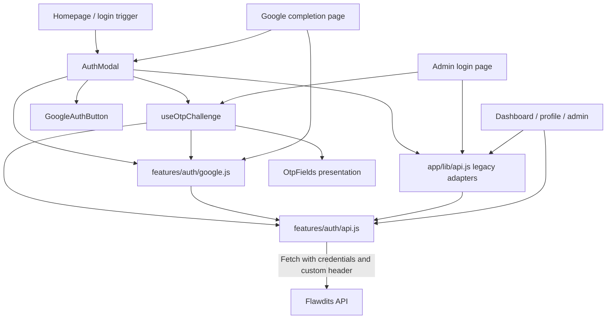
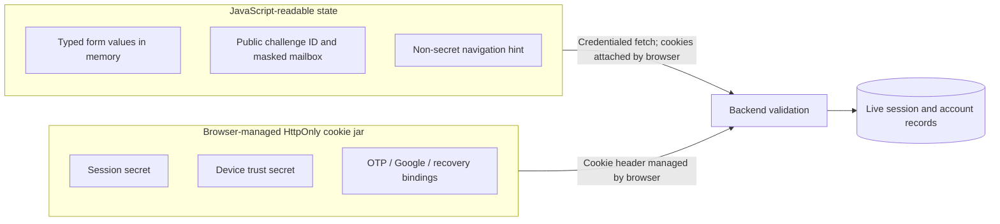
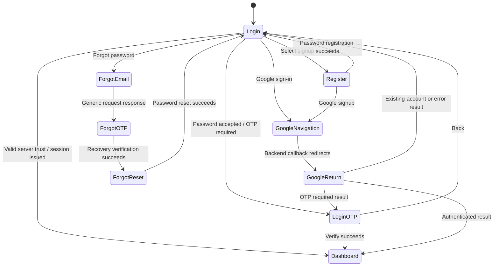
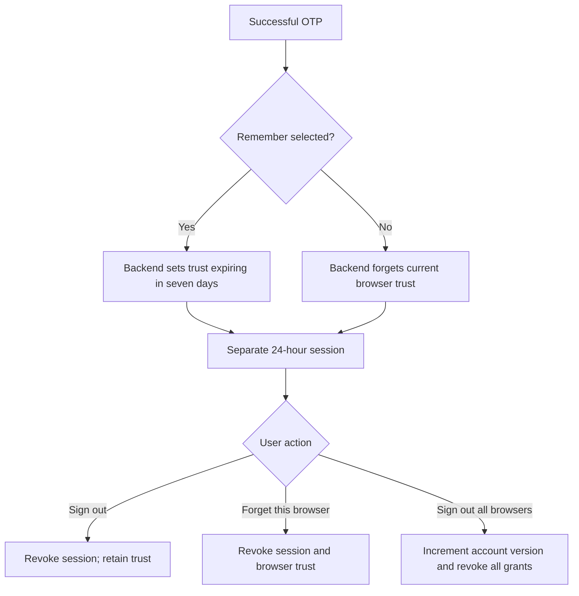
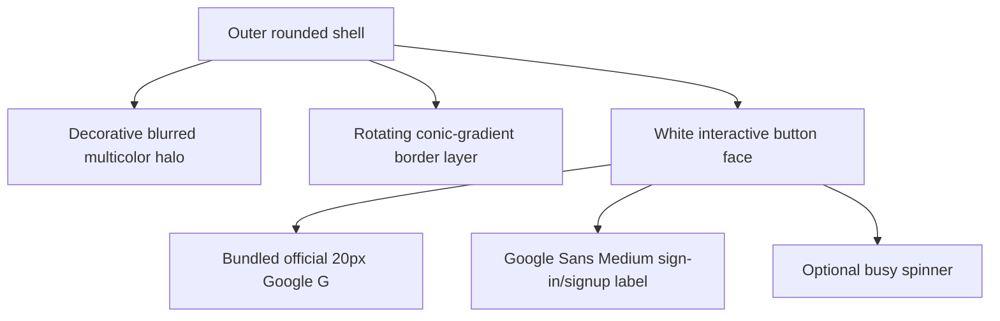

<div align="center">

# FLAWDITS · The Authentication Experience

**Frontend developer guide · Password sign-in · Email OTP · Google sign-in**

A precise map of the screens, state, requests and browser boundaries behind the experience.

**Edition:** 2026 · **Source review:** 15 October 2026

[Source map](#1-source-map-and-component-ownership) · [Screen states](#3-the-authentication-screen-state-machine) · [Google journey](#5-google-sign-in-and-signup) · [OTP interface](#6-the-shared-otp-experience) · [Troubleshooting](#13-troubleshooting-without-exposing-secrets) · [Learning](#16-youtube-learning-library)

</div>

---

> **Authentication terminology:** project history may call username/password sign-in “JWT auth.” Today, this frontend uses **HttpOnly cookie sessions** for both password and Google authentication. It does not read a login JWT, decode claims for authorization, or put bearer tokens in localStorage. Google's ID token is a JWT handled and verified entirely by the backend. The `/auth/token` endpoint keeps its older name but returns challenge or authenticated status, not a frontend bearer token.

This is an implementation guide for developers changing forms, navigation, transport, recovery, or authentication styling. The [backend companion](../flawdits-backend/AUTHENTICATION.md) explains cryptographic validation, Mongo schemas, atomic operations and rate budgets in depth. The source files linked here define the actual current behavior.

## Contents

1. [Source map and component ownership](#1-source-map-and-component-ownership)
2. [What the browser may know](#2-what-the-browser-may-know)
3. [The authentication screen state machine](#3-the-authentication-screen-state-machine)
4. [Password sign-in and registration](#4-password-sign-in-and-registration)
5. [Google sign-in and signup](#5-google-sign-in-and-signup)
6. [The shared OTP experience](#6-the-shared-otp-experience)
7. [Transport and response contracts](#7-transport-and-response-contracts)
8. [Seven-day trust, logout and profile actions](#8-seven-day-trust-logout-and-profile-actions)
9. [Recovery screens](#9-recovery-screens)
10. [Route entry, expiry and report streams](#10-route-entry-expiry-and-report-streams)
11. [Motion, branding and accessibility](#11-motion-branding-and-accessibility)
12. [Environment and Google console handoff](#12-environment-and-google-console-handoff)
13. [Troubleshooting without exposing secrets](#13-troubleshooting-without-exposing-secrets)
14. [Maintenance and manual review matrix](#14-maintenance-and-manual-review-matrix)
15. [Concept reference shelf](#15-concept-reference-shelf)
16. [YouTube learning library](#16-youtube-learning-library)

## 1. Source map and component ownership



| File | Owns | Does not own |
| --- | --- | --- |
| [app/components/AuthModal.js](app/components/AuthModal.js) | User login/register/recovery views, Google start/resume/cancel, loading/errors, focus and transitions. | Token verification, OTP attempt authority, account creation decisions. |
| [app/features/auth/api.js](app/features/auth/api.js) | `browserFetch`, auth JSON actions, password OTP verify/resend, hints, session check, logout/forget/revoke. | Reading HttpOnly cookies or issuing credentials. |
| [app/features/auth/google.js](app/features/auth/google.js) | Google start/result/verify/resend/cancel adapters; allowlisted authorization destination. | Google code exchange, client secret, provider token decoding. |
| [app/features/auth/hooks/useOtpChallenge.js](app/features/auth/hooks/useOtpChallenge.js) | In-memory challenge, input, remember choice, countdowns, provider dispatch. | Screens, global auth state, security clocks. |
| [app/features/auth/components/OtpFields.js](app/features/auth/components/OtpFields.js) | Shared accessible code field, delivery hint, countdown, remember, resend and back. | Requests or route transitions. |
| [app/features/auth/components/GoogleAuthButton.js](app/features/auth/components/GoogleAuthButton.js) | Google label, official icon, font, busy state and hover/press motion. | Starting OAuth itself; caller supplies `onClick`. |
| [app/features/auth/auth.module.css](app/features/auth/auth.module.css) | OTP layout and authentication feedback styles. | Application-wide security decisions. |
| [app/features/auth/google.module.css](app/features/auth/google.module.css) | Button light effects, completion page, reduced-motion CSS. | Provider login logic. |
| [app/auth/google/complete/page.js](app/auth/google/complete/page.js) | Read private callback result; navigate or resume modal. | Consuming OTP during an effect. |
| [app/lib/api.js](app/lib/api.js) | Existing profile/report/support/registration/password/recovery/admin adapters and expiry handling. | Local bearer-token storage. |
| [app/admin/login/page.js](app/admin/login/page.js) | Admin credential/OTP experience using the shared hook and field. | Regular-user Google login or Google-created admin accounts. |
| [app/admin/page.js](app/admin/page.js) | Admin session check and protected admin experience. | Granting admin rights from a browser flag. |
| [app/dashboard/page.js](app/dashboard/page.js) | Profile-based entry validation, expiry listener and report shell. | Trusting a localStorage hint as authorization. |
| [app/dashboard/profile/page.js](app/dashboard/profile/page.js), [app/components/ProfileModal.js](app/components/ProfileModal.js) | Profile security actions, recovery entry and account data presentation. | Server-side account revocation logic. |
| [public/auth/google-g.png](public/auth/google-g.png), [asset notes](public/auth/README.md) | Bundled official Google G and provenance. | A custom redrawn provider mark. |

Installed application versions at this review: Next.js 16.2.6, React 19.2.4, Framer Motion 12.x. Check [package.json](package.json) and lockfile before applying examples from other versions. Local `AGENTS.md` requires consulting the installed Next.js documentation before framework code changes.

## 2. What the browser may know



| Value | Location | Lifecycle / rule |
| --- | --- | --- |
| Password / typed OTP | Component or hook memory | Never persist as auth storage. Password is cleared after successful primary login response. |
| Public challenge ID / masked mailbox | Hook memory; Google result can restore metadata | References and display hints, never proof of authentication. |
| `flawdits_user_session_hint` | localStorage, literal value `1` | UX routing hint only; can be stale or edited by the user. |
| `flawdits_admin_session_hint` | localStorage, literal value `1` | Separate admin navigation hint, equally non-authoritative. |
| Session/device/recovery/flow secrets | HttpOnly backend cookies | Browser attaches them; frontend must not try to read or duplicate them. |
| Google client secret / Google ID token / PKCE verifier | Backend only | Never add them to page props, query strings, browser storage or `NEXT_PUBLIC_` variables. |

`markSession(kind)` removes historical `access_token` and `admin_access_token` localStorage entries before setting the selected non-secret hint. `clearSessionHint(kind)` removes that hint and the corresponding legacy token key. User sign-out also clears this tab's `sessionStorage` report cache; unrelated localStorage preferences remain.

The hints do not share authentication between user/admin roles. Setting either key manually cannot create the corresponding server session. A [JWT](https://www.rfc-editor.org/rfc/rfc7519) payload decoded in the browser would not provide that authority either.

## 3. The authentication screen state machine

`AuthModal` owns its `view` string; the OTP hook owns challenge state. Google uses an explicit `googleActive` provider switch rather than a new independent copy of OTP UI.



The actual view values are `login`, `register`, `login_otp`, `forgot_email`, `forgot_otp`, and `forgot_reset`. `GoogleNavigation`, `GoogleReturn`, and `Dashboard` in the diagram describe navigation stages, not additional `view` strings.

Important props:

| Prop | Role |
| --- | --- |
| `onSuccess` | Lets the caller navigate after verified authentication; callback page uses dashboard replacement. |
| `onClose` | Lets the caller close/navigate after any required Google cancellation. |
| `initialView` | Opens a particular modal step; default `login`. |
| `profileEmail` | Prefills recovery email for profile-initiated reset. |
| `initialGoogleResult` | Private backend result already fetched by the Google completion page. |

Loading guards disable repeated actions while requests run. Error/success/info feedback is presented inline. UI disabling improves usability; it is not the server's replay or concurrency control.

## 4. Password sign-in and registration

### 4.1 Login request and response branch

`loginUser(username, password)` in `app/lib/api.js` creates `URLSearchParams` and posts to `/auth/token` with `application/x-www-form-urlencoded`. The input label accepts username **or** email, but the form key stays `username` because the backend uses its existing password form parser.

```mermaid
sequenceDiagram
    actor User
    participant Modal as AuthModal
    participant Adapter as app/lib/api.js
    participant API as Backend
    User->>Modal: Submit username/email and password
    Modal->>Adapter: loginUser(identifier, password)
    Adapter->>API: POST /auth/token with cookies and header
    alt otp_required
        API-->>Modal: Public challenge metadata; browser stores binding cookie
        Modal->>Modal: Clear password; flow.begin(data); view = login_otp
        User->>Modal: Enter code; select optional remember
        Modal->>API: POST /auth/login/verify
        API-->>Modal: authenticated; browser stores session
        Modal->>Modal: markSession and onSuccess
    else already authenticated through valid trust
        API-->>Modal: authenticated; browser stores session
        Modal->>Modal: Clear password; markSession; onSuccess
    else rejected
        API-->>Modal: Error response
        Modal->>User: Explain error; keep form usable
    end
```

The server, not the browser, decides whether trust permits skipping OTP. There is no local seven-day timestamp or `remembered=true` bypass. Even within the trust period, password sign-in still requires the password.

### 4.2 Registration

The register view gathers username, email and password. It checks required inputs and disposable domains for immediate feedback, then calls `registerUser` with JSON at `/auth/create-user`. The backend repeats authoritative validation and uniqueness checks.

On success, the modal shows “Registration successful! Please log in,” changes to `login`, and clears the password. There is no automatic session from this registration request. The next password login follows OTP/trust rules. **Google signup instead holds a pending account and completes account creation after OTP.** Keep that difference clear in product copy.

Client domain checks are a convenience; bypassing JavaScript must not bypass backend checks. Likewise, password constraints enforced in HTML cannot substitute for backend UTF-8 byte limits and hashing policy.

### 4.3 Admin login

`app/admin/login/page.js` calls `adminLogin` at `/auth/admin/token` and uses `useOtpChallenge('admin')`. It either begins the shared OTP screen or marks an admin hint and navigates to `/admin` after server success. The OTP verify/resend bodies carry `kind: admin`. Google authentication is not offered as an admin account creation path.

## 5. Google sign-in and signup

### 5.1 Start from the current screen

`handleGoogle` chooses `intent: signup` in the register view and `intent: login` otherwise. It sets loading and Google-specific busy state, clears feedback, and calls `startGoogle`.

`startGoogle` posts through the shared transport, parses `authorization_url`, and requires:

- Origin exactly `https://accounts.google.com`.
- Path exactly `/o/oauth2/v2/auth`.

Only then does the modal call `window.location.assign`. This is a full-page redirect, not a popup or a frontend Google SDK token exchange. The frontend never constructs PKCE secrets or submits the Google client secret.

### 5.2 Backend callback versus frontend completion route

```mermaid
sequenceDiagram
    participant Page as Login/Register page
    participant API as api.flawdits.com
    participant Google
    participant Return as Frontend completion page
    Page->>API: POST /auth/google/start {intent}
    API-->>Page: authorization_url + HttpOnly state binding
    Page->>Google: location.assign
    Google-->>API: Browser redirect to /auth/google/callback?code&state
    Note over API: Verify provider, match identity, prepare OTP or session
    API-->>Return: 303 to /auth/google/complete + private result cookie
    Return->>API: POST /auth/google/result
    API-->>Return: Private state and fresh timing metadata
    alt authenticated
        Return->>Return: markSession; router.replace('/dashboard')
    else otp_required
        Return->>Return: AuthModal(initialGoogleResult); resume shared OTP UI
    else account_exists or error
        Return->>Return: AuthModal login form with appropriate message
    end
```

These URLs have separate jobs:

| URL | Owner | Role |
| --- | --- | --- |
| `/auth/google/callback` on API | Backend | Receives Google's transient code/state and validates them. |
| `/auth/google/complete` on frontend | Next.js page | Reads a cookie-bound private result and resumes UI. |

Register the **backend** callback in Google Cloud Console. Do not replace it with the frontend completion URL.

### 5.3 Completion page behavior

The completion page is a client component. On mount it calls `googleResult()`, shows an accessible loading status, and branches on the result. An `active` flag prevents late promise resolution from updating state after effect cleanup. It does not abort the network request itself.

The result endpoint is intentionally repeatable: React development remounts or a page reload must not consume an OTP, create another account, or reset server timers. The OTP verification POST is a separate explicit action. If result lookup fails, the page supplies an error result to `AuthModal` and lets the user restart.

Authenticated results use `router.replace('/dashboard')`, keeping the completion screen out of the immediate back-navigation step. Close returns to `/?login=true`. The completion URL carries no Google token, email proof, session secret or OTP.

### 5.4 Product decisions the frontend must preserve

| Situation | Screen behavior |
| --- | --- |
| Sign in with Google; account does not exist | Resume signup OTP and ask for a username; no separate signup visit required. |
| Sign up with Google; account does not exist | Same OTP/username experience. |
| Sign up with Google; account already exists | Switch to login, optionally prefill supplied account email, show clear informational sign-in guidance. |
| Sign in with Google; matching password account exists | OTP, then backend links Google to the same account; existing password stays usable. |
| Already-linked Google account on trusted browser | Backend issues session; completion page navigates directly. |
| First Google link, even on password-trusted browser | OTP remains required. Do not hide it using a local hint. |
| Duplicate/conflicting identity, suspension or provider error | Display bounded server message; do not guess an account or auto-create another one. |

### 5.5 Username during Google signup

The extra field is rendered only when the shared OTP screen is Google-active and `flow.challenge.is_new_account` is true. It is trimmed by `verifyGoogle` and sent only as optional metadata; the backend requires it for signup.

Rules: 3–40 characters; first character letter/digit/underscore; remaining characters letters/digits/underscore/dot/hyphen. The HTML pattern escapes the hyphen for the browser pattern syntax. Backend regex validation remains authoritative. A precheck of availability happens before consuming the OTP, so an already-taken username can normally be corrected without asking for another code. Final races may still require restarting.

Google-only users have no fabricated password. The frontend must not invent one, require a random hidden password field, or say their Google password is stored by Flawdits. They can use recovery later to set a separate password.

### 5.6 Back, close and browser history

For an active Google OTP, Back awaits `cancelGoogle()` before clearing the local hook, provider flag, username and password and returning to login. Close cancels when Google context is active/present, then invokes the caller's close action. Failed cancellation is surfaced rather than silently reporting that server state was revoked.

The modal listens for `pageshow` with `event.persisted` to clear loading/busy state when the browser restores the original page from its back-forward cache. Without this, Back after Google navigation could restore a button that remains visually busy. The listener is removed on unmount.

Ordinary password OTP Back resets local hook state; it is not a server-side cancellation endpoint. Restarting password login replaces that browser's same-purpose challenge, and expiry eventually removes abandoned state. Do not promise that local `flow.reset()` revokes server records.

## 6. The shared OTP experience

### 6.1 Hook inputs and state

`useOtpChallenge(kind = 'user', provider = 'password')` is shared by user password, user Google and admin password login. `AuthModal` selects provider from its Google-active flag; admin uses password and admin scope.

| Hook value | Meaning |
| --- | --- |
| `challenge` | Public metadata plus local display deadlines. Null before begin/after reset. |
| `otp`, `setOtp` | In-memory code input, preserving leading zeroes. |
| `remember`, `setRemember` | Opt-in trust choice; false for every new challenge. |
| `begin(data)` | Save metadata, derive display deadlines, clear old OTP and remember choice. |
| `resend()` | Call provider-specific endpoint; update timing; clear old code; retain current remember choice. |
| `verify(username?)` | Dispatch password or Google verification using the current challenge and remember choice. |
| `reset()` | Clear local challenge/code/remember state only. |
| `expiresIn`, `resendIn` | Clamped seconds remaining for display. |

### 6.2 Display clocks and authoritative clocks

At response receipt, the hook computes local milliseconds:

```text
# Display conversion only. The backend owns security timestamps and eligibility.
expiresAt = browserNowMilliseconds + expires_in_seconds × 1000
resendAt  = browserNowMilliseconds + resend_after_seconds × 1000

# Recomputed for display; never sent as authority to the backend.
expiresIn = max(0, ceil((expiresAt - displayedClock) / 1000))
resendIn  = max(0, ceil((resendAt - displayedClock) / 1000))
```

A one-second interval exists only while a challenge exists and is cleaned up on challenge change/unmount. A throttled background tab can delay a visible tick; absolute display deadlines prevent treating tick counts as elapsed time. Browser time edits can still change the display, while the server independently rejects expired or ineligible actions.

| Backend constraint | UI implication |
| --- | --- |
| Code expires after five minutes | Countdown reaches zero; expired submit is disabled in the forms. |
| Overall challenge ends after ten minutes | Resend cannot keep authentication alive forever. |
| Resend waits 60 seconds | Disable resend and show seconds remaining. |
| At most five guesses | Show the server's remaining-attempt/error message; do not maintain a competing client authority. |
| Replacement invalidates old code | Clear input after resend and tell the user to use the latest email. |
| Resend preserves attempts | Never say a resend resets guesses. |

When resend rejects with a readable `Retry-After`, the hook updates the displayed cooldown and rethrows so the modal can show the error. For cross-origin requests that header must be exposed by CORS to JavaScript; the current backend CORS declaration does not explicitly expose it. Enforcement is unaffected; verify deployment header exposure before relying on that UI synchronization path.

Google result reloads obtain recalculated timing from the backend. Password OTP metadata lives in memory and is not automatically restored from localStorage after a full reload. These flows have deliberately different recovery mechanisms.

### 6.3 Code input, paste and instructions

`OtpFields` uses a text input with `inputMode="numeric"`, `autoComplete="one-time-code"`, a six-digit pattern and six-character bound. A numeric input would lose the distinction between `012345` and `12345`, so keep it as text.

Both change and paste sanitize non-digits before taking six digits. Paste is intercepted before native truncation, so a code copied with spaces can still become six valid characters. Backend validation still requires ASCII digits and performs its own digest comparison.

`useId()` connects labels and instruction/expiry descriptions without collisions between component instances. The instructions show the masked destination and suggest checking spam. The code expires display is separate from resend eligibility: an expired code may still be replaced within the overall challenge lifetime.

Remember is explicit opt-in with a shared-device warning. Resend and Back have `type="button"` so they do not accidentally submit the enclosing OTP form. Loading disables inputs and actions; forms also prevent repeated handler execution.

## 7. Transport and response contracts

### 7.1 One browser transport

`browserFetch(url, options)` wraps fetch with:

| Option | Value and reason |
| --- | --- |
| `credentials` | `include`: send API-host cookies across the frontend/API origin boundary. |
| `cache` | `no-store`: avoid cached authentication state. |
| `X-Flawdits-Request` | `1`: required backend mutation marker; also forces cross-origin preflight. |
| Caller headers | Preserved through `Headers`, with the required marker enforced. |

Credentials/cache are applied after caller options, so a caller cannot accidentally omit them. Fetch normally does not throw for HTTP 400/401/503; adapters inspect `response.ok` and parse the body. A network/CORS failure instead throws without a readable server response.

`authAction(path, body = {})` provides JSON POSTs beneath `/auth/` for provider adapters. The existing `app/lib/api.js` adapters retain their established routes and encoding. Do not replace form-encoded password login with JSON without changing the backend contract too.

### 7.2 Adapter map

| Frontend function | Backend request | Important outcome |
| --- | --- | --- |
| `registerUser` | `POST /auth/create-user` | Returns success to UI; not a logged-in session. |
| `loginUser` | `POST /auth/token` | Challenge or authenticated result. |
| `adminLogin` | `POST /auth/admin/token` | Same two outcomes in admin scope. |
| `verifyLogin` | `POST /auth/login/verify` | Marks hint only after success. |
| `resendLogin` | `POST /auth/login/resend` | Replacement display metadata. |
| `startGoogle` | `POST /auth/google/start` | Validated authorization destination. |
| `googleResult` | `POST /auth/google/result` | Repeatable private handoff lookup. |
| `verifyGoogle` | `POST /auth/google/verify` | Trimmed username when relevant; marks hint after success. |
| `resendGoogle` | `POST /auth/google/resend` | Preserves provider/signup context in returned metadata. |
| `cancelGoogle` | `POST /auth/google/cancel` | Revokes known unfinished context. |
| `checkSession` | `GET /auth/session?kind=...` | Marks hint on success; clears on explicit 401. |
| `logoutSession` | `POST /auth/logout` or `/auth/devices/forget` | Await revocation before clearing hints and notifying UI. |
| `revokeAllDevices` | `POST /auth/devices/revoke-all` | Requires current session; clears hint and notifies after success. |

### 7.3 Example response shapes

These are structural examples, not real account data or usable credentials. Placeholder challenge IDs are explanatory.

```json
{
  "status": "otp_required",
  "challenge_id": "<public-challenge-reference>",
  "masked_email": "d•••@example.invalid",
  "expires_in": 300,
  "resend_after": 60
}
```

Google OTP results additionally include `is_new_account` and a human-readable `message`. A successful session response is:

```json
{
  "status": "authenticated",
  "username": "<account-username>"
}
```

The session secret is in Set-Cookie, not this JSON. The frontend never needs to extract it.

### 7.4 Errors and response differences

The feature auth transport exposes an Error with `status` and numeric `retryAfter`; it uses a string `detail` or a generic validation message. `app/lib/api.js` has its own `extractError` helper that also handles FastAPI detail arrays and nested objects. Do not assume every adapter formats validation errors identically.

| Failure | UI handling principle |
| --- | --- |
| 400 | Explain expired/replaced/incorrect code or invalid flow; follow restart guidance. |
| 401 | Bad login or lost session, depending on endpoint; clear hints on explicit session loss. |
| 403 | Suspension or request-verification failure; inspect message and deployment settings. |
| 409 | Show identity/username conflict; never automatically merge accounts in UI. |
| 422 | Malformed request/field validation; check encoding, shape and field bounds. |
| 429 | Preserve state when appropriate and respect server cooldown. |
| 503 | Mail/provider/configuration unavailable; display retry or password fallback guidance. |
| Fetch failure | No accessible HTTP response; inspect reachability and CORS before blaming credentials. |

Never show arbitrary raw provider payloads or add token-bearing logs for debugging. The Google backend supplies bounded messages through the private result.

## 8. Seven-day trust, logout and profile actions



The browser stores no local trust deadline. A remembered browser means the browser profile still holds an account-specific backend cookie. Another browser, private session, cleared cookie, expired trust, reset or revocation requires OTP again. A different IP alone is not a new device test.

Seven days is a **fixed** interval from successful OTP plus opt-in. A trusted sign-in does not restart it. The 24-hour session has a separate lifetime: seven-day trust does not mean seven days continuously signed in. Expiring trust does not terminate a current valid session.

Profile actions call `logoutSession('user', forget)` or `revokeAllDevices()`. On successful revocation, transport clears the hint/cache and dispatches `auth-expired` (or `admin-auth-expired` for admin scope). These are same-window UI events, not authorization proofs or cross-tab synchronization. Another tab loses server access on its next validation, even if its visible UI has not yet changed.

Revocation is awaited before navigation or reporting success. If the network call fails, show the error; simply clearing localStorage would leave the server session valid and should not be described as completed server logout.

## 9. Recovery screens

The recovery screens are owned by `AuthModal`, with separate `recoveryChallenge`, recovery `otp`, new password and confirmation state. They do not currently reuse the login OTP hook/component for the complete recovery journey. Do not assume login resend/countdown UX automatically applies to recovery.

| View | Action | Successful transition |
| --- | --- | --- |
| `forgot_email` | `forgotPasswordRequestOtp(email)` posts `/auth/forgot-password`. | Store returned challenge ID, clear recovery code, show generic message, move to `forgot_otp`. |
| `forgot_otp` | `forgotPasswordVerifyOtp(email, otp, challengeId)` posts `/auth/verify-otp`. | Browser receives restricted reset cookie; move to `forgot_reset`. |
| `forgot_reset` | `forgotPasswordReset(email, otp, newPassword, confirmPassword)` posts `/auth/reset-password`. | Clear user session hint/password/code; return to login with success feedback. |

The first response is deliberately generic: “If an account exists…” does not prove a mailbox is registered. The recovery verification cookie has reset privileges only, never protected API access. Backend reset requires that unexpired, one-use grant; the compatibility `otp` submitted by the final adapter is not the authorization mechanism.

The frontend checks password confirmation for immediate feedback. The backend enforces at least 12 characters and at most 72 UTF-8 bytes, with request-field bounds too. Google-only accounts can use recovery to establish a password. Successful reset revokes old sessions and remembered browsers, so copy must instruct a fresh sign-in rather than automatically navigating as authenticated.

## 10. Route entry, expiry and report streams

### 10.1 Session checks

`checkSession(kind)` asks the server, marks the hint on success, and clears it only on an explicit 401. Network errors propagate; they are not proof that a session has been revoked.

On homepage mount, the page attempts `checkSession()` unless the URL explicitly requests the login/logout experience. Its CTA separately uses the non-secret hint to choose dashboard navigation versus opening the modal; the hint does not authorize that destination. The dashboard itself fetches `/auth/me` through `getUserProfile`, populates profile state and enables its authenticated view after success. Admin entry uses `checkSession('admin')` before loading protected admin data. Profile entry fetches protected profile/ticket/report data and handles failure.

These are client navigation checks, not Next.js server middleware enforcement. Every backend protected endpoint must still validate the cookie independently. Do not add sensitive content merely because a page component can render or a hint exists.

### 10.2 Expiry coordination

`authFetch` wraps protected regular-user API requests. On 401 it clears the user hint and dispatches `auth-expired`; dashboard listeners navigate to `/?login=true`. `adminAuthFetch` clears the admin hint and sends the browser to `/admin/login` on 401.

Dashboard effect cleanup removes listeners and ignores late profile responses. It does not implement continuous session polling or cross-tab logout broadcast. Server validation remains the final control even when a tab displays stale authenticated UI.

### 10.3 Report WebSockets

Report adapters derive WebSocket endpoints from the API origin and create native `WebSocket` connections. Browsers send eligible API-host cookies automatically; JavaScript does not set an Authorization header or put JWTs into URL parameters. Some two-stage report flows send/validate a job ID, which is a report reference rather than a login credential.

The backend separately verifies WebSocket Origin and session at connection establishment. A normal fetch CORS policy is not WebSocket authorization. Already-open streams are not continuously revalidated by the current session helper; do not promise immediate termination after global logout unless that behavior is added.

## 11. Motion, branding and accessibility

### 11.1 Modal transitions

The existing Flawdits auth shell/illustration remains the visual frame. `AnimatePresence` and keyed view content coordinate exit/entry transitions; motion layout smooths size changes between credential, OTP and recovery forms. The modal uses `useReducedMotion` to reduce transition displacement/duration. Admin login uses the same principle with its existing visual shell.

Loading state and feedback stay associated with the current task. The error/info/success styles live in the feature CSS module. Preserve meaningful instructions at each step: which mailbox, latest code, expiry, resend eligibility and what Back will do.

### 11.2 Google button anatomy



| Detail | Current implementation |
| --- | --- |
| Typography | `Google_Sans` through `next/font/google`, Latin subset, weight 500, swap display. |
| Icon | Local `/auth/google-g.png`, rendered with Next Image at 20 × 20, decorative empty alt. |
| Face | White, recognizable provider label; minimum 48px height, visible focus outline. |
| Border | Decorative conic-gradient orbit, eight-second base rotation; hover speeds it up. |
| Glow | Multicolor blurred halo; stronger on hover/focus. |
| Hover/press | Framer Motion lift of 2px / press scale 0.985 when motion and state permit. |
| Spring | Stiffness 360, damping 24. |
| Busy/disabled | Real button is disabled and reports `aria-busy`; caller controls request state. |
| Hit testing | Decorative layers use no pointer events; they must not intercept the action. |
| Reduced motion | Motion hook suppresses interactive transforms; CSS disables orbit/spinner animation and transitions. |

Google mark provenance is recorded in [public/auth/README.md](public/auth/README.md). Consult [Google's branding requirements](https://developers.google.com/identity/branding-guidelines) before editing logo, font, face or label. The surrounding effects are the custom treatment; this document does not claim independent Google approval or certification of the design.

`next/font` makes the font part of the application asset pipeline; a build can need connectivity to obtain it. A font download failure does not indicate that the OAuth token exchange failed. Diagnose build assets and runtime authentication separately.

### 11.3 Keyboard and assistive technology

The modal captures the previous focused element, moves focus into the form, traps Tab/Shift+Tab among visible controls, and restores previous focus on cleanup. Escape triggers the close control when closing is available and loading does not block it. Unique OTP field IDs connect labels and help/expiry descriptions. The callback loading view uses `role="status"` and `aria-live="polite"`; error feedback uses appropriate alert semantics in the forms.

When editing view transitions, check that focus remains useful after content replacement and errors are discoverable by keyboard/screen reader users. Existing behavior should be reviewed manually; this documentation is not an accessibility audit or a claim of complete standards compliance.

## 12. Environment and Google console handoff

### Frontend environment

| Environment | `NEXT_PUBLIC_API_BASE_URL` |
| --- | --- |
| Local | `http://localhost:8000` |
| Production | `https://api.flawdits.com` |

This value is public and used by browser code; it must be browser-reachable and match the deployed API. Next.js public environment values are normally inlined into browser bundles at build time, so update the hosting environment and rebuild/redeploy when changing the API destination. Never add secrets with the public prefix.

### Backend values the frontend depends on

| Setting | Local | Production |
| --- | --- | --- |
| `GOOGLE_REDIRECT_URI` | `http://localhost:8000/auth/google/callback` | `https://api.flawdits.com/auth/google/callback` |
| `AUTH_FRONTEND_URL` | `http://localhost:3000` | `https://www.flawdits.com` |
| `AUTH_COOKIE_SECURE` | false for HTTP | true |
| `AUTH_COOKIE_SAMESITE` | lax | lax for current deployment |
| `AUTH_ALLOWED_ORIGINS` | Exact localhost/127.0.0.1 origins actually used | Exact canonical and bare origins actually served/allowed |

The Google console web client registers the backend callback URI exactly. Basic identity scopes are `openid`, email and profile; no Gmail-reading permission is needed. Outbound OTP mail is sent by the backend SMTP service, not by browser access to a user's Gmail inbox.

JavaScript origins can include `http://localhost:3000` and `https://www.flawdits.com`; add other frontend origins only when they actually host the flow. Console audience/test-user settings must permit the account used for testing. Production credentials/environment are configured on the backend, not in the frontend repository.

### Origin versus site

`https://www.flawdits.com` and `https://api.flawdits.com` are different **origins**, so fetch requires CORS and `credentials: include`. They are HTTPS hosts under the same registrable domain, so they are ordinarily **same-site** for cookie policy. `localhost` and `127.0.0.1` are different hosts; do not start on one and silently switch callbacks to the other.

Using unrelated frontend and API sites changes cookie constraints and can trigger third-party-cookie restrictions even with credentials included. Prefer the existing same-site deployment or a carefully configured reverse proxy. Read [MDN CORS](https://developer.mozilla.org/en-US/docs/Web/HTTP/Guides/CORS) and [Set-Cookie](https://developer.mozilla.org/en-US/docs/Web/HTTP/Reference/Headers/Set-Cookie) before changing domains.

## 13. Troubleshooting without exposing secrets

| What the developer sees | What to inspect |
| --- | --- |
| “Failed to fetch” on login | Browser Console/Network: OPTIONS, TLS, reachability, exact request origin and API destination. A CORS failure can occur before credentials reach login logic. |
| No response body visible in DevTools | Network/CORS errors may block response access; this is not proof that JSON parsing or passwords are wrong. |
| OPTIONS has no allow-origin response | Backend allowlist, backend health and proxy response; credentialed CORS cannot use `*` as an easy fix. |
| Password login works but Google start fails | Backend Google environment/client configuration; start is independent of password validation. |
| Google returns to wrong site | `AUTH_FRONTEND_URL` and Cloud Console backend callback settings; do not accept arbitrary browser return URLs as a workaround. |
| `redirect_uri_mismatch` | Compare registered and actual backend callback byte-for-byte. |
| Completion page cannot find result | Cookie host/policy, same browser profile, ten-minute handoff expiry, cancellation, or backend state cleanup. |
| New Google user gets username error | Length/allowed characters/uniqueness; keep entered code if the precheck did not consume it. |
| Code expired despite countdown | Server is authoritative; network delay, stale UI, browser-clock edits or replaced generation can differ from display. |
| Resend error but no updated timer | Check whether `Retry-After` is exposed by CORS. Do not weaken server cooldown to make UI match. |
| Remember option seems ineffective | Check browser profile/cookies, account/role, fixed seven-day window, revocation and first-time Google linking. |
| Back from Google leaves controls busy | Inspect `pageshow` BFCache listener and loading restoration. |
| Editing localStorage does not log in | Expected: hints are not server credentials. |
| Font build error | Diagnose `next/font` connectivity/assets separately from OAuth runtime. |
| Logout action fails | Preserve error feedback; local hint deletion alone cannot revoke the server credential. |

Inspect cookie **attributes**, request routes and redacted statuses rather than copying raw cookie values. Do not share complete HAR files, callback query strings, screenshots of credentials, email OTPs, or provider responses without redaction. Never paste a real Google ID token or session credential into an online decoder.

## 14. Maintenance and manual review matrix

When changing authentication, use the existing shared transport and hook boundaries. A new provider should receive its own backend validation adapter, not an independent frontend bearer store. Keep backend-authoritative decisions explicit in UI copy.

### Scenarios for the developer's manual review

| Scenario | Expected behavior |
| --- | --- |
| Password login, new browser | Credentials transition into OTP without authenticated navigation. |
| Correct OTP with remember unchecked | Session issued; browser trust not retained. |
| Correct OTP with remember checked | Session and fixed seven-day trust issued. |
| Logout and password login within trust | Password still required; OTP skipped by server. |
| Another/private browser | OTP required. |
| Wrong/expired/replaced code | Clear explanation; no navigation as authenticated. |
| Resend | Cooldown honored, input cleared, latest-code guidance, remember choice preserved. |
| Google login for unknown identity | Ask username plus OTP; successful verification creates account. |
| Google signup for an existing email | Informational sign-in guidance; no duplicate account. |
| Google login for password account | OTP before linking; original password remains usable. |
| Linked Google plus trusted browser | Return page validates server result and reaches dashboard. |
| Google cancel, Back, reload and BFCache | Usable form, correct result restoration/expiry and intentional cancellation. |
| Session expires or revoke-all elsewhere | Next protected request rejected; current UI handles expiry. |
| Password recovery | Generic request response, separate reset grant, fresh login after reset. |
| Keyboard-only / paste / mobile code autofill | Labeled field, leading zeroes, useful focus and no accidental form submits. |
| Reduced motion | Decorative animation reduced while task remains understandable. |
| Admin alongside user session | Independent scopes; Google does not provision admin access. |

This matrix is guidance for manual review, not a claim these scenarios were automatically tested as part of writing this document. Frontend/browser testing and screenshots are left to the project owner unless explicitly requested.

### Refactoring invariants

- Do not store session credentials, OTPs or provider tokens in localStorage/sessionStorage.
- Never route to success merely because password validation returned `otp_required`.
- Preserve Google versus password challenge dispatch and user versus admin scope.
- Keep callback result lookup repeatable and verification as a separate user action.
- Do not turn countdown values or navigation hints into access-control checks.
- Await server revocation before presenting logout/forget as successful.
- Keep provider identity matching, password policy, attempts and trust deadlines on the backend.
- Preserve visible labels, disabled/busy states, focus behavior, reduced motion and approved asset provenance.
- Remember that email OTP is not phishing-resistant. For Google sign-in, provider identity and mailbox OTP may depend on the same account; avoid claims of independent factors that the implementation cannot guarantee.
- Update detailed source comments and both companion guides when changing shared contracts. Existing workspace commenting instructions apply to every new code addition.

## 15. Concept reference shelf

| Concept | Reference | Connect it to this implementation |
| --- | --- | --- |
| Fetch credentials | [MDN Request.credentials](https://developer.mozilla.org/en-US/docs/Web/API/Request/credentials) | Why every API adapter goes through `browserFetch`. |
| Cookies | [MDN Set-Cookie](https://developer.mozilla.org/en-US/docs/Web/HTTP/Reference/Headers/Set-Cookie) | HttpOnly secrets, Secure production and same-site behavior. |
| CORS | [MDN CORS guide](https://developer.mozilla.org/en-US/docs/Web/HTTP/Guides/CORS) | Preflight, exact origins, credentials and readable response headers. |
| Sessions | [OWASP Session Management](https://cheatsheetseries.owasp.org/cheatsheets/Session_Management_Cheat_Sheet.html) | The server credential behind a browser's logged-in experience. |
| CSRF | [OWASP CSRF Prevention](https://cheatsheetseries.owasp.org/cheatsheets/Cross-Site_Request_Forgery_Prevention_Cheat_Sheet.html) | Why a custom mutation marker and allowed origin accompany cookies. |
| JWT | [RFC 7519](https://www.rfc-editor.org/rfc/rfc7519) | Google's signed identity token is distinct from our opaque session. |
| Google OIDC | [Google protocol guide](https://developers.google.com/identity/openid-connect/openid-connect) | Server callback, signed identity, scopes and subjects. |
| PKCE | [RFC 7636](https://www.rfc-editor.org/rfc/rfc7636) | What the backend protects while the frontend redirects. |
| Google branding | [Provider design guidance](https://developers.google.com/identity/branding-guidelines) | Preserve recognizable provider identity while styling the surrounding button. |
| Effect lifecycle | [React useEffect](https://react.dev/reference/react/useEffect) | Callback result reads, timer/listener cleanup and development remounts. |
| Next.js public environment | [Environment variables](https://nextjs.org/docs/app/guides/environment-variables) | Browser API destination and why public variables must never contain secrets. |
| Reduced motion | [MDN prefers-reduced-motion](https://developer.mozilla.org/en-US/docs/Web/CSS/@media/prefers-reduced-motion) | Keep the auth flow comfortable without depending on motion. |

---

<div align="center">

### ✦ Experience & engineering credits ✦

**SAM DAS**  
**Lead Developer · 2026**

Flawdits authentication · Developer reference collection

[GitHub · Samaresh-Das](https://github.com/Samaresh-Das) &nbsp; · &nbsp; [LinkedIn · Sam Das](https://www.linkedin.com/in/samaresh-d-ab9621212/) &nbsp; · &nbsp; [Explore the portfolio ↗](https://portfolio-2-tau-sable.vercel.app/)

*Thoughtful interfaces. Explicit security boundaries. A clear path for future developers.*

</div>

---

## 16. YouTube learning library

Use these to understand concepts, then trace the source files in this guide. Some videos predate current OAuth recommendations. Do not copy historical implicit-flow or browser bearer-storage examples into this cookie-session application.

| Watch | What to map back to Flawdits |
| --- | --- |
| [An Illustrated Guide to OAuth and OpenID Connect — OktaDev](https://www.youtube.com/watch?v=t18YB3xDfXI) | Identify the frontend, backend and provider; explain why the frontend never needs Google's client secret. |
| [OAuth 2.0 and OpenID Connect in plain English — OktaDev](https://www.youtube.com/watch?v=996OiexHze0) | Distinguish user login, API authorization and identity tokens. Treat implicit-flow sections as historical context. |
| [Authorization Code flow with PKCE — OktaDev](https://www.youtube.com/watch?v=Udrrz00PD3k) | Follow the full-page redirect, backend callback and verifier exchange behind `startGoogle`. |

After watching, follow `AuthModal → google.js → completion page → useOtpChallenge → verifyGoogle`. Then follow password login and explain why both journeys finish with the same browser-managed session mechanism.
